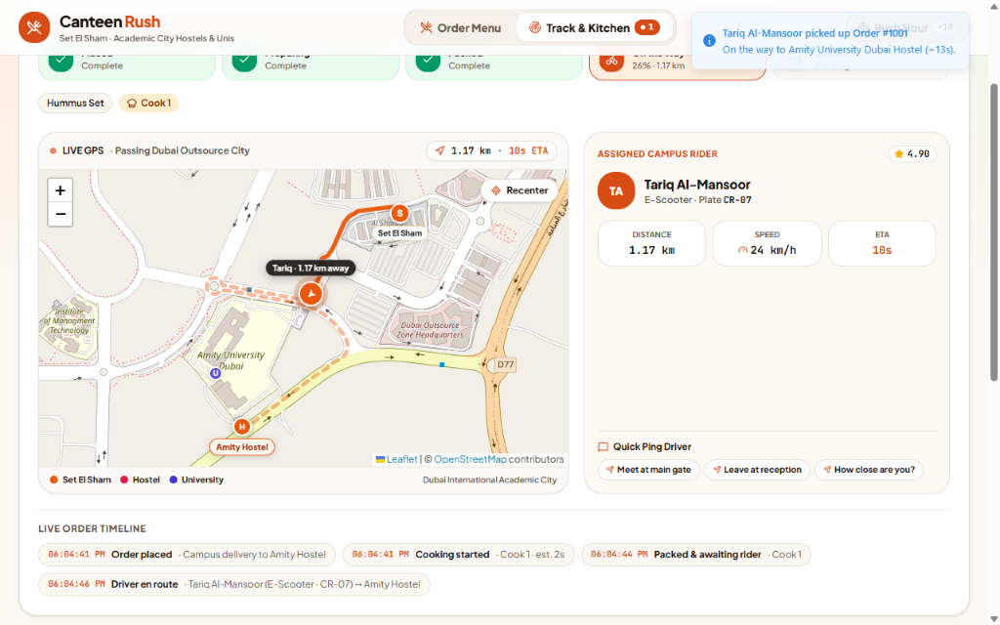
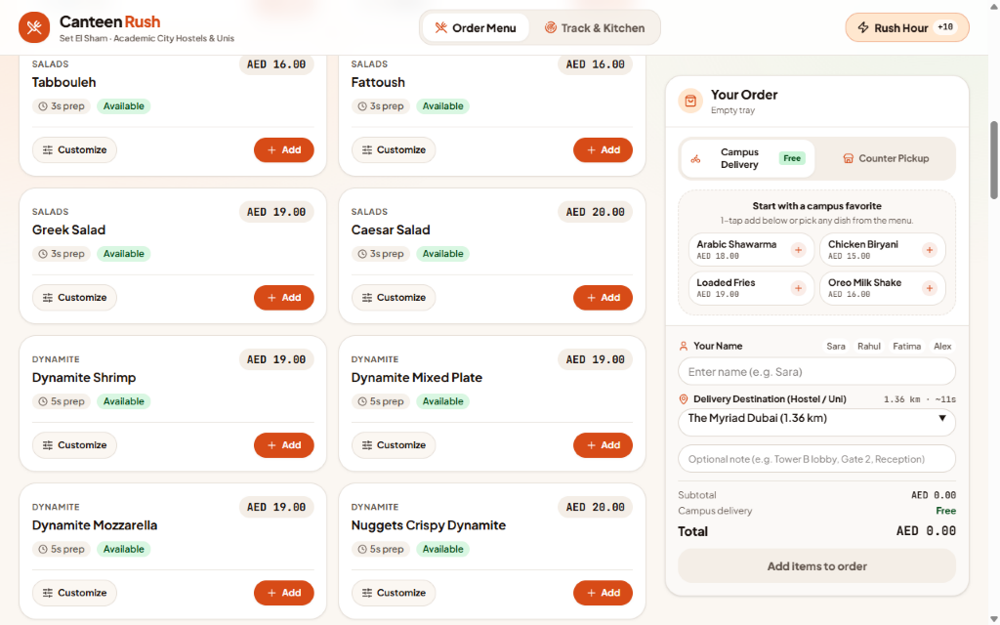
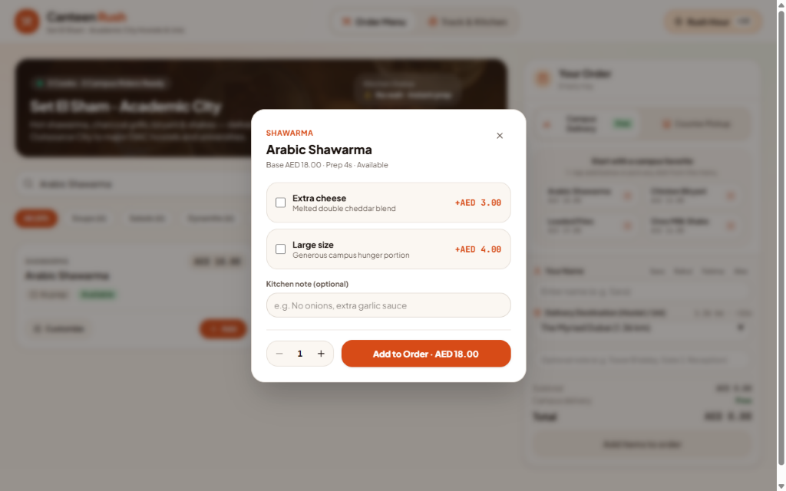

<div align="center">

# Canteen Rush

**Campus food ordering, real-time kitchen queue, and live GPS delivery driver tracking for Set El Sham in Dubai International Academic City (DIAC).**

[](https://campus-crunch-counter.vercel.app)


</div>

---

## Preview

### Live GPS Delivery Driver Tracker (Dubai International Academic City)

Real **OpenStreetMap** street tiles centered on **Set El Sham Restaurant** (Dubai Outsource City) with road-following routes, animated directional rider markers, live distance & ETA telemetry, and quick driver pings.



### Streamlined Ordering & Express Checkout

Browse 59 Set El Sham dishes with instant search, fast-prep filtering, 1-tap `+ Add` steppers, inline Campus Delivery / Counter Pickup checkout, and 1-tap campus favorites.

| Order Menu & Sticky Checkout | Dish Customization Modal |
| :---: | :---: |
|  |  |

---

## Key Features

- **Effortless Menu & Ordering**
  - Instant search across **59 dishes** in **11 categories**, `Fast Prep ≤4s` quick filter, and clear `Available` / `Unavailable` status badges.
  - 1-tap `+ Add` buttons that transform into inline `− / +` steppers, plus a keyboard-accessible customization modal (`Extra cheese`, `Large size`, quantity, and kitchen notes).
  - Always-visible desktop order tray (with mobile sticky bottom bar + slide-over drawer), 1-tap popular quick-adds, quick-fill student names, and inline validation.
- **Live Order Progress & Delivery Driver Tracker**
  - Automatic switch to live tracking on checkout plus a persistent mini-tracker banner while browsing the menu.
  - 5-stage Delivery stepper (`Placed` → `Preparing` → `Packed` → `On the Way` → `Delivered`) and 3-stage Pickup stepper with live ETA countdowns, activity timeline, receipts, and 1-tap **Reorder**.
  - Interactive **Leaflet + OpenStreetMap** map tracing real DIAC roads with a pulsing directional rider marker, secondary active fleet pins, **Recenter** control, and **Quick Ping Driver** messaging with instant replies.
- **Real-Time Kitchen & Fleet Simulation**
  - Unified deterministic simulation loop managing **3 kitchen cooks** (`Cook 1–3`) and **3 campus riders** (`Tariq Al-Mansoor`, `Nadia Hassan`, `Rohan Nair`) including post-delivery return trips.
  - **Rush Hour (+10)** button dispatches 10 randomized hostel/university deliveries and counter pickups simultaneously to stress-test the kitchen line and live map.

---

## Dubai Academic City Delivery Coverage

All routes depart from **Set El Sham Restaurant** (`Dubai Outsource City`) along real DIAC street geometry:

| Category | Destination | Road Distance |
| :--- | :--- | :---: |
| **Hostel** | The Myriad Dubai | `1.36 km` |
| **Hostel** | Amity University Dubai Hostel | `1.58 km` |
| **Hostel** | KSK Homes Student Residence | `1.80 km` |
| **Hostel** | Manipal University Hostel | `2.29 km` |
| **University** | Amity University Dubai | `1.15 km` |
| **University** | University of Birmingham Dubai | `1.59 km` |
| **University** | Curtin University Dubai | `1.67 km` |
| **University** | BITS Pilani Dubai Campus (BPDC) | `1.77 km` |
| **University** | Manipal Academy (MAHE Dubai) | `2.33 km` |
| **University** | American University in the Emirates (AUE) | `2.42 km` |

---

## Tech Stack

| Layer | Technology |
| :--- | :--- |
| **Framework & Routing** | TanStack Start, TanStack Router, React 19, TypeScript |
| **Styling & Motion** | Tailwind CSS v4 (OKLCH design tokens), Framer Motion, Lucide Icons, Sonner |
| **Live Mapping** | Leaflet (client-side lazy-loaded for SSR safety), OpenStreetMap tiles |
| **Testing & Quality** | Vitest, React Testing Library, ESLint, Prettier |
| **Deployment** | Vercel (GitHub auto-deploy on `main`) |

---

## Project Structure

```text
src/
├── components/
│   ├── MenuBrowser.tsx      # Hero banner, search, category pills, dish cards & customize modal
│   ├── CartSidebar.tsx      # Sticky checkout tray, Delivery/Pickup toggle, grouped Hostel/Uni picker
│   ├── OrderTracker.tsx     # 5-stage progress stepper, rider telemetry, quick pings & timeline
│   ├── DeliveryMap.tsx      # SSR-safe Leaflet + OpenStreetMap live GPS map & fleet markers
│   ├── KitchenBoard.tsx     # 3-cook line, 3-rider fleet strip, queue lanes & order history
│   └── ReceiptModal.tsx     # Thermal-style itemized order receipt modal
├── hooks/
│   └── use-canteen-simulation.ts  # Unified kitchen, inventory & delivery fleet state machine
├── lib/
│   ├── campus.ts            # Real DIAC coordinates, OSRM road waypoints & route interpolation
│   ├── menu.ts              # 59 Set El Sham dishes, categories & popular quick-adds
│   └── types.ts             # Order lifecycle types, progress/ETA & AED/distance formatters
├── routes/
│   ├── __root.tsx           # Document head, fonts & global Toaster
│   └── index.tsx            # Main responsive workspace & view switcher
└── test/
    ├── app-routing.test.tsx
    └── canteen-ordering-and-tracker.test.tsx
```

---

## Getting Started

```bash
# Install dependencies
npm install

# Start local development server
npm run dev

# Run unit & component tests
npm test

# Type-check, lint, and build for production
npx tsc --noEmit
npm run lint
npm run build
```
